  
  
  

###

<h1 data-importer="text" align="center">hey there, I'm ZapDX 👋</h1>

###

<h3 data-importer="text" align="left">👩‍💻  About Me</h3>

###

### Hi there, I'm ZapDX 👋

Informatics Engineering student and software developer focused on building clean, scalable web applications and practical AI solutions.

- 🌱 **I’m currently learning:** Scalable backend architectures, cloud deployment, and applied machine learning
- 👯 **I’m looking to collaborate on:** Open-source projects, web applications, and developer tools
- 💬 **Ask me about:** Web development, Python, JavaScript/TypeScript, and software engineering fundamentals
- 📫 **How to reach me:** `[zahraadityap09@gmail.com]` | [LinkedIn](https://linkedin.com/in/zapdx)

###

<h3 data-importer="text" align="left">🛠 Language and tools</h3>

###

  
  
  
  
  
  
  
  
  
  
  
  
  
  
  
  
  
  
  
  
  

###

<h3 data-importer="text" align="left">🎨 Design tools</h3>

###

  
  
  
  
  
  
  

###

<h3 data-importer="text" align="left">🔥   My Stats :</h3>

###

  
  

###
